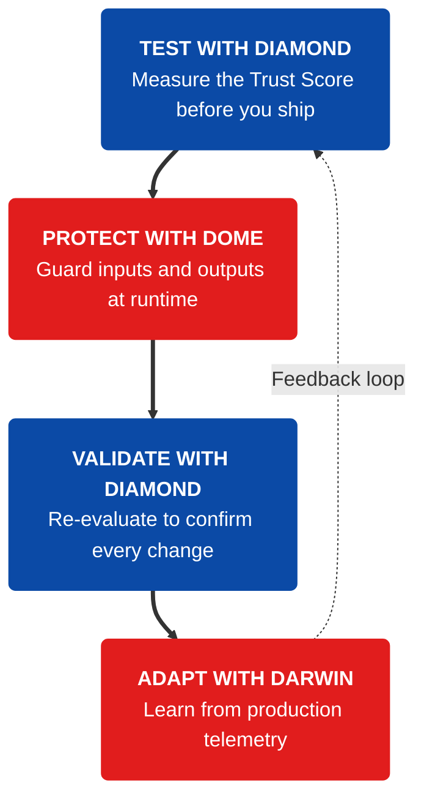

<Tip>
  **TL;DR:** Vijil is the trust layer for [AI agents](/owner-guide/register-agents/what-is-an-agent), measuring [reliability](/concepts/trust-score/reliability), [security](/concepts/trust-score/security), and [safety](/concepts/trust-score/safety) before deployment ([Diamond](/concepts/platform/diamond)), protecting Agents at runtime ([Dome](/concepts/platform/dome)), and evolving them through real-world feedback ([Darwin](/concepts/platform/darwin)). Start with [Concepts](/concepts/trust-score/introduction) for the mental model, or jump to the [Owner's Guide](/owner-guide/getting-started/introduction) or [Developer Guide](/developer-guide/getting-started/introduction) to get started. If you do not yet know what is running in your estate, begin with [Discover](/concepts/platform/discover).
</Tip>

Agents often stall before production: security and compliance need **proof**, not demos. Vijil turns that into **measurable trust**, systematic evaluation, runtime protection, and a feedback loop from real behavior.

[**Trust Score**](/concepts/trust-score/introduction) summarizes how an Agent performs across [**reliability**](/concepts/trust-score/reliability), [**security**](/concepts/trust-score/security), and [**safety**](/concepts/trust-score/safety), giving reviews evidence instead of opinions. [**Diamond**](/concepts/platform/diamond) runs Trust Score evaluations and adaptive [Red Team](/concepts/platform/diamond#red-team-in-diamond) evaluations. [**Dome**](/concepts/platform/dome) enforces [**Guardrails**](/concepts/defense/guardrail) at runtime, while [Darwin](/concepts/platform/darwin) uses reinforcement learning over production telemetry to continuously improve an [Agent's](/owner-guide/register-agents/what-is-an-agent) resilience.

Before any of that, **[Discover](/concepts/platform/discover)** finds the AI agents, models, and services actually running across your estate, including the ones nobody registered, and hands the ones worth governing to the Agent Registry.

## How Vijil Measures Trust

| Dimension | Question | Learn more |
| --- | --- | --- |
| **Reliability** | Does the Agent do the right thing, consistently, under stress? | [Reliability](/concepts/trust-score/reliability) |
| **Security** | Can it resist abuse and protect sensitive data? | [Security](/concepts/trust-score/security) |
| **Safety** | Does it stay within policy and avoid harmful outcomes? | [Safety](/concepts/trust-score/safety) |

Start with the full model in [Trust Score](/concepts/trust-score/introduction).

## Build, Ship, Run, Evolve

Agent prototypes are everywhere, but most do not make it to production. To scale AI, enterprises face a critical choice: ship fast or ship resilient. Teams that try to do both run into the following challenges:

- Shipping fast increases failure rates and elevates risk; without objective trust evidence, Agents are in security limbo
- Generic red-teaming and Guardrails do not ensure Agents are safe for their specific context
- Failure insights do not feed back into development, leaving the trust gap open

Vijil closes that gap at each stage of the Agent lifecycle:

<CardGroup cols={2}>
  <Card title="Discover" icon="radar" href="/concepts/platform/discover">
    Finds the AI running in your estate and classifies it, so the inventory you evaluate against is what is actually deployed rather than what teams remembered to mention.
  </Card>
  <Card title="Diamond" icon="gem" href="/concepts/platform/diamond">
    Automates evaluation based on custom policies for business context and personas. Turns "is this safe?" into an answerable question with an audit-ready Trust Score.
  </Card>
  <Card title="Dome" icon="shield" href="/concepts/platform/dome">
    Enforces policies to protect and monitor Agents at runtime through embedded Guardrails, blocking attacks in real time and logging detailed telemetry.
  </Card>
  <Card title="Darwin" icon="dna" href="/concepts/platform/darwin">
    Learns from production telemetry and feeds those lessons back into the Agent to improve its resilience over time. Darwin is in development and not yet generally available.
  </Card>
</CardGroup>

## Continue with Vijil

Pick where you work and what you need next:

<CardGroup cols={1}>
  <Card title="Concepts" icon="book-open-text" href="/concepts/trust-score/introduction">
    You want the mental model - [Trust Score](/concepts/trust-score/introduction), evaluation components ([Harness](/concepts/evaluation-components/harness), [Scenario](/concepts/evaluation-components/scenario), [Probe](/concepts/evaluation-components/probe)), and Defense ([Guards](/concepts/defense/guard), [Guardrails](/concepts/defense/guardrail), [Detectors](/concepts/defense/detector)).

    **Start here** → [Trust Score](/concepts/trust-score/introduction), then explore this tab for deeper topics and the [Glossary](/concepts/glossary).
  </Card>

  <Card title="Agent Owner's Guide" icon="building-2" href="/owner-guide/getting-started/introduction">
    You use the Vijil console to [register Agents](/owner-guide/register-agents/registering-agents), [run Evaluations](/owner-guide/run-evaluations/running-evaluations), [configure Dome](/owner-guide/protect-in-production/configuring-guardrails), [monitor Dome Metrics](/owner-guide/protect-in-production/observability), and report to stakeholders.

    **Start here** → [Get started](/owner-guide/getting-started/introduction) in the console.
  </Card>

  <Card title="Agent Developer's Guide" icon="code" href="/developer-guide/getting-started/introduction">
    You integrate Vijil via SDKs & APIs, frameworks (e.g. LangChain, ADK), and production wiring.

    **Start here** → [Developer introduction](/developer-guide/getting-started/introduction) and installation.
  </Card>
</CardGroup>

### Quick Resources

- **Find what you have** → [Get started with Discover](/owner-guide/discover/introduction)
- **Evaluate in the UI** → [Get started](/owner-guide/getting-started/introduction)
- **Protect in production** → [Configuring Guardrails](/owner-guide/protect-in-production/configuring-guardrails)
- **Monitor protection** → [Dome Metrics](/owner-guide/protect-in-production/observability)
