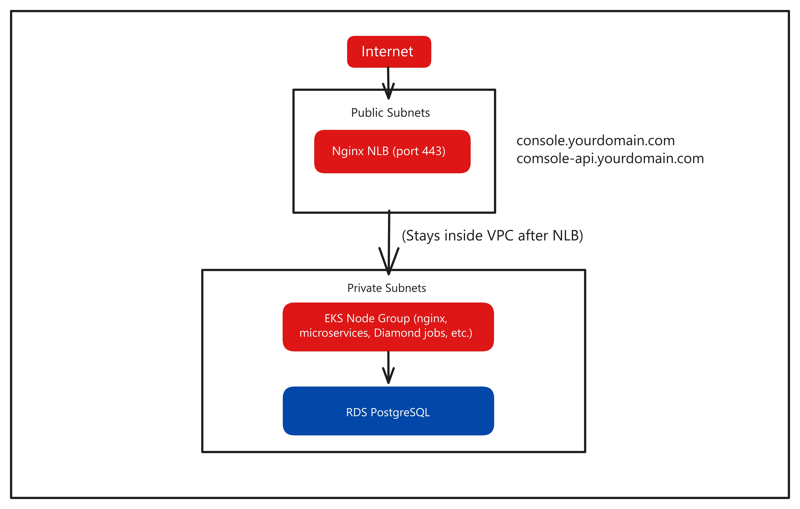

> **Already have a cluster and AWS resources?** Jump to [Step 2: IAM and EKS Add-ons](#step-2-iam-and-eks-add-ons) and then [Step 3: Helm Values and Secrets](#step-3-helm-values-and-secrets).

## Prerequisites

Before you start, make sure you have the following tools installed and configured:

| Requirement | Details |
|---|---|
| [AWS CLI](https://aws.amazon.com/cli/) | Configured and working — `aws sts get-caller-identity` should succeed |
| [`eksctl`](https://docs.aws.amazon.com/eks/latest/eksctl/what-is-eksctl.html) | ≥ 0.160 |
| [`kubectl`](https://kubernetes.io/docs/reference/kubectl/) | ≥ 1.33 (keep client within one minor version of the server) |
| [`helm`](https://helm.sh/docs/intro/install/) | ≥ 3.8 |
| Domain + DNS | A registered domain with a Route 53 hosted zone (or another DNS provider) |
| Container images | Access to Vijil's ECR, or the release images mirrored to your own registry |
| Helm chart | Distributed as an OCI artifact from Vijil's ECR (same access as container images) |

The repository scripts used in this guide also require a checkout of `vijil-console`, Python 3.12, and Poetry. Ask Vijil for access to the scripts and chart version for your release before starting.

## Resource Checklist

Before starting, review the full list of AWS resources and external services this guide will walk you through creating. Items marked **Vijil + Customer** or **Vijil** require Vijil to update access policies on their side — request this early.

<Warning>
**Three steps require Vijil's involvement** before you can proceed:
1. **ECR Pull Access** (Step 2) — Vijil must grant your AWS account pull access to their container registry
2. **Diamond Artifacts** (Step 2) — Vijil must copy Diamond evaluation artifacts (~4.5 MB) to your S3 bucket
3. **Detector Model Downloads** (Step 2): Vijil must provide the Detector model files (~900 MB) at a bucket your evaluation Jobs can read
</Warning>

| Resource | Required? | Who Creates It | Guide Section |
|---|---|---|---|
| VPC + subnets | Yes | Customer | [Step 1: VPC](#vpc) |
| EKS Cluster (OIDC enabled) | Yes | Customer | [Step 1: EKS](#eks-cluster) |
| RDS PostgreSQL | Yes | Customer | [Step 1: RDS](#rds-postgresql) |
| S3 Bucket | Yes | Customer | [Step 1: S3](#s3-bucket) |
| ACM Certificate | Yes | Customer | [Step 1: ACM](#acm-certificate) |
| ECR Cross-Account Pull | Yes (if using Vijil ECR) | **Vijil + Customer** | [Step 2: ECR](#ecr-pull-access) |
| Diamond Artifacts | Yes | **Vijil** copies to your bucket | [Step 2: Diamond Artifacts](#diamond-artifacts) |
| Detector Models | Yes | **Vijil + Customer** | [Step 2: Detector Model Downloads](#detector-model-downloads) |
| LLM API Key | Yes | Customer (Groq, OpenAI, Anthropic, or local) | [Step 3: Secrets](#step-3-helm-values-and-secrets) |
| Darwin (separate Helm chart) | If evolution enabled | Customer | [Step 4.5: Darwin](#step-4-5-deploy-darwin-evolution-engine) |
| Route 53 DNS Records | Yes | Customer | [Step 5: DNS](#step-5-dns) |

## Architecture Overview



All application workloads and the database live in **private subnets**. A single [Network Load Balancer (NLB)](https://docs.aws.amazon.com/elasticloadbalancing/latest/network/introduction.html) in the **public subnets** routes traffic to NGINX. Both `console.*` and `console-api.*` resolve to this NLB, and NGINX routes frontend and API traffic internally. EKS nodes reach S3 and ECR through the NAT Gateway.

This guide uses the chart's default NLB. The chart can also front NGINX with an Application Load Balancer through `nginx.albIngress`, which requires the AWS Load Balancer Controller.

---

## Step 1: AWS Infrastructure

### VPC

Create a VPC with two public and two private subnets across two [Availability Zones](https://docs.aws.amazon.com/AWSEC2/latest/UserGuide/using-regions-availability-zones.html). The subnet tags are **required**. EKS uses them to discover subnets, and the [AWS Load Balancer Controller](https://kubernetes-sigs.github.io/aws-load-balancer-controller/) uses them to place NLBs correctly.

```bash
export AWS_REGION=us-west-2
export VPC_NAME=vijil-prod

# Create VPC
VPC_ID=$(aws ec2 create-vpc \
  --cidr-block 10.0.0.0/16 \
  --region $AWS_REGION \
  --query 'Vpc.VpcId' --output text)

aws ec2 create-tags --resources $VPC_ID \
  --tags Key=Name,Value=$VPC_NAME

# Enable DNS hostnames (required for EKS)
aws ec2 modify-vpc-attribute --vpc-id $VPC_ID --enable-dns-hostnames

# Internet Gateway
IGW_ID=$(aws ec2 create-internet-gateway \
  --query 'InternetGateway.InternetGatewayId' --output text)
aws ec2 attach-internet-gateway --vpc-id $VPC_ID --internet-gateway-id $IGW_ID
```

**Public subnets**: the NLB goes here. Each subnet must have the `kubernetes.io/role/elb=1` tag:

```bash
# Replace us-west-2a / us-west-2b with your AZs
PUBLIC_SUBNET_1=$(aws ec2 create-subnet \
  --vpc-id $VPC_ID --cidr-block 10.0.1.0/24 \
  --availability-zone ${AWS_REGION}a \
  --query 'Subnet.SubnetId' --output text)

PUBLIC_SUBNET_2=$(aws ec2 create-subnet \
  --vpc-id $VPC_ID --cidr-block 10.0.2.0/24 \
  --availability-zone ${AWS_REGION}b \
  --query 'Subnet.SubnetId' --output text)

for SUBNET in $PUBLIC_SUBNET_1 $PUBLIC_SUBNET_2; do
  aws ec2 create-tags --resources $SUBNET --tags \
    Key=Name,Value="$VPC_NAME-public" \
    Key=kubernetes.io/role/elb,Value=1
  aws ec2 modify-subnet-attribute --subnet-id $SUBNET \
    --map-public-ip-on-launch
done

# Route table: public subnets → Internet Gateway
PUBLIC_RT=$(aws ec2 create-route-table --vpc-id $VPC_ID \
  --query 'RouteTable.RouteTableId' --output text)
aws ec2 create-route --route-table-id $PUBLIC_RT \
  --destination-cidr-block 0.0.0.0/0 --gateway-id $IGW_ID
for SUBNET in $PUBLIC_SUBNET_1 $PUBLIC_SUBNET_2; do
  aws ec2 associate-route-table --subnet-id $SUBNET --route-table-id $PUBLIC_RT
done
```

**Private subnets**: EKS nodes and RDS go here. Each subnet must have the `kubernetes.io/role/internal-elb=1` tag:

```bash
PRIVATE_SUBNET_1=$(aws ec2 create-subnet \
  --vpc-id $VPC_ID --cidr-block 10.0.3.0/24 \
  --availability-zone ${AWS_REGION}a \
  --query 'Subnet.SubnetId' --output text)

PRIVATE_SUBNET_2=$(aws ec2 create-subnet \
  --vpc-id $VPC_ID --cidr-block 10.0.4.0/24 \
  --availability-zone ${AWS_REGION}b \
  --query 'Subnet.SubnetId' --output text)

for SUBNET in $PRIVATE_SUBNET_1 $PRIVATE_SUBNET_2; do
  aws ec2 create-tags --resources $SUBNET --tags \
    Key=Name,Value="$VPC_NAME-private" \
    Key=kubernetes.io/role/internal-elb,Value=1
done

# NAT Gateway in the first public subnet (lets private nodes reach ECR and S3)
EIP=$(aws ec2 allocate-address --domain vpc \
  --query 'AllocationId' --output text)
NAT_GW=$(aws ec2 create-nat-gateway \
  --subnet-id $PUBLIC_SUBNET_1 --allocation-id $EIP \
  --query 'NatGateway.NatGatewayId' --output text)
echo "Waiting for NAT Gateway..."
aws ec2 wait nat-gateway-available --nat-gateway-ids $NAT_GW

# Route table: private subnets → NAT Gateway
PRIVATE_RT=$(aws ec2 create-route-table --vpc-id $VPC_ID \
  --query 'RouteTable.RouteTableId' --output text)
aws ec2 create-route --route-table-id $PRIVATE_RT \
  --destination-cidr-block 0.0.0.0/0 --nat-gateway-id $NAT_GW
for SUBNET in $PRIVATE_SUBNET_1 $PRIVATE_SUBNET_2; do
  aws ec2 associate-route-table --subnet-id $SUBNET --route-table-id $PRIVATE_RT
done
```

### EKS Cluster

```bash
export CLUSTER_NAME=vijil-prod
export ACCOUNT_ID=$(aws sts get-caller-identity --query Account --output text)

eksctl create cluster \
  --name $CLUSTER_NAME \
  --region $AWS_REGION \
  --version 1.34 \
  --vpc-private-subnets=$PRIVATE_SUBNET_1,$PRIVATE_SUBNET_2 \
  --vpc-public-subnets=$PUBLIC_SUBNET_1,$PUBLIC_SUBNET_2 \
  --with-oidc \
  --nodegroup-name standard-workers \
  --node-type r5.xlarge \
  --node-volume-size 200 \
  --nodes 3 \
  --nodes-min 2 \
  --nodes-max 8 \
  --managed

# Verify
kubectl get nodes
```

<Note>
**`--with-oidc` is required.** It enables the OIDC provider used by the EBS CSI driver's IRSA configuration. Do not omit it.
</Note>

#### Cluster Sizing Guidance

Vijil Console deploys its service pods (NGINX, frontend, teams, console, agent-environment, Diamond, and Dome) plus telemetry (Grafana, Loki, Mimir, Tempo) and pre-install database migration Jobs. It creates on-demand Job pods in separate namespaces for evaluations (`vijil-diamond`), custom Harness generation (`vijil-harness`), red-teaming (`vijil-xteaming`), cloud inventory scans (`vijil-discover`), and code scans (`vijil-scan`).

| Profile | Node Type | Nodes | vCPU Total | Memory Total | Use Case |
|---------|-----------|-------|------------|--------------|----------|
| **Minimum** | `m5.xlarge` | 2 | 8 vCPU | 32 GiB | Small teams, light evaluation load |
| **Recommended** | `r5.xlarge` | 3 | 12 vCPU | 96 GiB | Production use with concurrent evaluations |
| **Dev reference** | `r5.xlarge` | 6 | 24 vCPU | 192 GiB | Vijil's own dev cluster (headroom for testing) |

**Why memory-optimized (r5)?** Evaluation and red-team jobs are memory-intensive. `r5` instances provide a better $/GiB ratio than general-purpose `m5` for this workload. Each evaluation runs as its own Kubernetes Job that requests 500m CPU and 2 GiB of memory, with limits of 2 CPU and 4 GiB. Size your nodes for the number of evaluations you expect to run at once. To change these values, set `evaluationJobs.resources` in your Helm values.

Diamond evaluation Jobs also request 2 GiB of ephemeral storage for downloaded Detector models.
Adjust this with `evaluationJobs.resources.requests.ephemeral-storage` in your Helm values.

**Disk:** 200 GiB gp3 per node (default 80 GiB is tight when telemetry PVCs and container images accumulate). Set via `--node-volume-size 200` in eksctl.

**Autoscaling:** Enable Cluster Autoscaler or Karpenter. Set `--nodes-min` to your baseline and `--nodes-max` high enough to absorb burst evaluation jobs. Each Diamond/red-team job runs as a separate pod — 5 concurrent evaluations means 5 extra pods.

### RDS PostgreSQL

```bash
# Security group: allow port 5432 from EKS nodes only
RDS_SG=$(aws ec2 create-security-group \
  --group-name vijil-rds-sg \
  --description "RDS access from EKS nodes" \
  --vpc-id $VPC_ID \
  --query 'GroupId' --output text)

EKS_NODE_SG=$(aws eks describe-cluster --name $CLUSTER_NAME \
  --query 'cluster.resourcesVpcConfig.clusterSecurityGroupId' --output text)

aws ec2 authorize-security-group-ingress \
  --group-id $RDS_SG \
  --protocol tcp --port 5432 \
  --source-group $EKS_NODE_SG

# Subnet group using private subnets
aws rds create-db-subnet-group \
  --db-subnet-group-name vijil-prod-subnets \
  --db-subnet-group-description "Vijil Console RDS subnets" \
  --subnet-ids $PRIVATE_SUBNET_1 $PRIVATE_SUBNET_2

# Custom parameter group with SSL disabled
# PostgreSQL 15+ defaults to rds.force_ssl=1; this lets the app connect without SSL
# for in-VPC-only traffic. Remove this if your app connection string uses SSL.
aws rds create-db-parameter-group \
  --db-parameter-group-name vijil-pg15-no-ssl \
  --db-parameter-group-family postgres15 \
  --description "Vijil Console RDS — SSL disabled for in-VPC clients"

aws rds modify-db-parameter-group \
  --db-parameter-group-name vijil-pg15-no-ssl \
  --parameters "ParameterName=rds.force_ssl,ParameterValue=0,ApplyMethod=pending-reboot"

# Create RDS instance
aws rds create-db-instance \
  --db-instance-identifier vijil-prod-pg \
  --db-instance-class db.t3.medium \
  --engine postgres \
  --engine-version 15 \
  --master-username postgres \
  --master-user-password YOUR_STRONG_PASSWORD \
  --db-name postgres \
  --allocated-storage 20 \
  --storage-type gp3 \
  --no-publicly-accessible \
  --vpc-security-group-ids $RDS_SG \
  --db-subnet-group-name vijil-prod-subnets \
  --db-parameter-group-name vijil-pg15-no-ssl \
  --backup-retention-period 7

# Wait for it to be available (takes a few minutes), then get the endpoint
aws rds wait db-instance-available --db-instance-identifier vijil-prod-pg
RDS_ENDPOINT=$(aws rds describe-db-instances \
  --db-instance-identifier vijil-prod-pg \
  --query 'DBInstances[0].Endpoint.Address' --output text)
echo "RDS endpoint: $RDS_ENDPOINT"
```

### S3 Bucket

```bash
export S3_BUCKET=vijil-console-data-prod

aws s3api create-bucket \
  --bucket $S3_BUCKET \
  --region $AWS_REGION \
  --create-bucket-configuration LocationConstraint=$AWS_REGION

# Block all public access
aws s3api put-public-access-block \
  --bucket $S3_BUCKET \
  --public-access-block-configuration \
    BlockPublicAcls=true,IgnorePublicAcls=true,BlockPublicPolicy=true,RestrictPublicBuckets=true
```

Add a CORS configuration so the bucket can accept signed-URL file uploads from the browser:

```bash
cat > /tmp/s3-cors.json <<'EOF'
{
  "CORSRules": [
    {
      "AllowedHeaders": ["*"],
      "AllowedMethods": ["GET", "PUT", "POST", "HEAD"],
      "AllowedOrigins": ["https://*.yourdomain.com"],
      "ExposeHeaders": ["ETag", "x-amz-request-id", "x-amz-id-2"],
      "MaxAgeSeconds": 3000
    }
  ]
}
EOF

aws s3api put-bucket-cors --bucket $S3_BUCKET --cors-configuration file:///tmp/s3-cors.json
```

### ACM Certificate

Request a wildcard certificate to cover both `console.` and `console-api.` subdomains:

```bash
CERT_ARN=$(aws acm request-certificate \
  --domain-name "*.yourdomain.com" \
  --validation-method DNS \
  --region $AWS_REGION \
  --query 'CertificateArn' --output text)

echo "Certificate ARN: $CERT_ARN"
# Add the CNAME record from the ACM console to Route 53 to validate:
# aws acm describe-certificate --certificate-arn $CERT_ARN
```

Wait for `ISSUED` status before proceeding:

```bash
aws acm wait certificate-validated --certificate-arn $CERT_ARN
```

---

## Step 2: IAM and EKS Add-ons

### IAM Policy for S3

Create a scoped S3 policy for your app data bucket. If you are deploying to multiple environments, use distinct policy names (e.g. `VijilConsoleS3Access` for prod, `VijilConsoleS3AccessStaging` for staging) to avoid conflicts.

```bash
export S3_BUCKET=vijil-console-data-prod  # adjust per environment

cat > /tmp/vijil-s3-policy.json <<EOF
{
  "Version": "2012-10-17",
  "Statement": [
    {
      "Effect": "Allow",
      "Action": [
        "s3:GetObject",
        "s3:PutObject",
        "s3:DeleteObject",
        "s3:ListBucket"
      ],
      "Resource": [
        "arn:aws:s3:::${S3_BUCKET}",
        "arn:aws:s3:::${S3_BUCKET}/*"
      ]
    }
  ]
}
EOF

S3_POLICY_ARN=$(aws iam create-policy \
  --policy-name VijilConsoleS3Access \
  --policy-document file:///tmp/vijil-s3-policy.json \
  --query 'Policy.Arn' --output text)

echo "S3 policy ARN: $S3_POLICY_ARN"
```

### S3 Access for Pods

There are two supported approaches. **EKS Pod Identity (Option A)** and **Node IAM Role (Option B)**. EKS Pod Identity is recommended, it is what the current dev environment uses and scopes credentials to specific service accounts rather than all pods on a node.

#### Option A: EKS Pod Identity (recommended)

Pod Identity is the modern replacement for IRSA. Pods receive AWS credentials via `http://169.254.170.23/v1/credentials`, injected automatically by the Pod Identity Agent. The AWS SDK picks this up with no code changes.

```bash
# Step 1: Install the EKS Pod Identity Agent add-on
aws eks create-addon \
  --cluster-name $CLUSTER_NAME \
  --addon-name eks-pod-identity-agent \
  --region $AWS_REGION

kubectl -n kube-system rollout status daemonset/eks-pod-identity-agent

# Step 2: Create an IAM role for Pod Identity to assume
cat > /tmp/pod-identity-trust.json <<EOF
{
  "Version": "2012-10-17",
  "Statement": [
    {
      "Effect": "Allow",
      "Principal": { "Service": "pods.eks.amazonaws.com" },
      "Action": ["sts:AssumeRole", "sts:TagSession"]
    }
  ]
}
EOF

S3_ROLE_ARN=$(aws iam create-role \
  --role-name VijilConsoleS3Role \
  --assume-role-policy-document file:///tmp/pod-identity-trust.json \
  --query 'Role.Arn' --output text)

aws iam attach-role-policy \
  --role-name VijilConsoleS3Role \
  --policy-arn $S3_POLICY_ARN

# Step 3: Associate the role with every service account the chart uses for S3
# (format: namespace/service-account)
for NS_SA in \
  vijil-console/default \
  vijil-console/diamond-service \
  vijil-console/agent-environment-service \
  vijil-diamond/default \
  vijil-harness/harness-service \
  vijil-xteaming/xteaming-service \
  vijil-scan/scan-service; do
  aws eks create-pod-identity-association \
    --cluster-name $CLUSTER_NAME \
    --namespace "${NS_SA%%/*}" \
    --service-account "${NS_SA##*/}" \
    --role-arn $S3_ROLE_ARN \
    --region $AWS_REGION
done
```

| Namespace | Service account | Used by |
|---|---|---|
| `vijil-console` | `diamond-service` | Diamond API, which creates evaluation, custom Harness, and red-team Jobs |
| `vijil-console` | `agent-environment-service` | Agent, persona, and policy APIs (policy document uploads) |
| `vijil-console` | `default` | Other Console pods |
| `vijil-diamond` | `default` | Diamond evaluation Jobs (read evaluation artifacts and Detector models, write results) |
| `vijil-harness` | `harness-service` | Custom Harness generation Jobs |
| `vijil-xteaming` | `xteaming-service` | Red-team Jobs |
| `vijil-scan` | `scan-service` | Code scan Jobs |

A missing association does not fail the install. The affected feature fails later, when its pod first calls S3.

**Cloud inventory scans** run in `vijil-discover` under the `discover-service` service account. Give it a **separate** role rather than `VijilConsoleS3Role`: it needs read-only inventory permissions on the AWS services you want scanned (for example Bedrock, SageMaker, Lambda, ECS, EKS, EC2, and IAM `List*`/`Get*`/`Describe*` actions), plus `s3:GetObject`, `s3:PutObject`, and `s3:ListBucket` on `teams/*/scans/*/*` in your app bucket. Ask Vijil for the current inventory policy. Skip this association if you do not use inventory scans.

#### Option B: Node IAM Role (simpler, broader scope)

Attach the S3 policy directly to the EKS node group role. All pods on every node in the cluster will inherit these permissions, simpler to set up but less isolated.

```bash
NODE_ROLE=$(aws eks describe-nodegroup \
  --cluster-name $CLUSTER_NAME \
  --nodegroup-name standard-workers \
  --query 'nodegroup.nodeRole' --output text | awk -F/ '{print $NF}')

aws iam attach-role-policy \
  --role-name $NODE_ROLE \
  --policy-arn $S3_POLICY_ARN
```

### EBS CSI Driver

The telemetry stack (Grafana, Loki, Mimir, Tempo) uses PersistentVolumeClaims backed by EBS. The driver must be installed **before** `helm install`.

Install the driver via Helm first (this creates the `ebs-csi-controller-sa` service account that the IRSA script needs), then run the IRSA setup script:

```bash
# Step 1: Install the driver
helm repo add aws-ebs-csi-driver https://kubernetes-sigs.github.io/aws-ebs-csi-driver
helm repo update
helm install aws-ebs-csi-driver aws-ebs-csi-driver/aws-ebs-csi-driver \
  --namespace kube-system

# Step 2: Configure IRSA (from the repo root)
export CLUSTER_NAME=$CLUSTER_NAME
export REGION=$AWS_REGION
export ACCOUNT_ID=$ACCOUNT_ID
./scripts/setup-ebs-csi-driver.sh

# Step 3: Restart the controller to pick up the IAM role
kubectl rollout restart deployment ebs-csi-controller -n kube-system

# Verify both controller replicas are running (expect 5/5)
kubectl get pods -n kube-system -l app=ebs-csi-controller
```

<Tip>
Alternatively, use the EKS managed add-on: `aws eks create-addon --cluster-name $CLUSTER_NAME --addon-name aws-ebs-csi-driver`

The EBS CSI driver deploys two controller replicas across AZs. Verify they show 5/5 Running before proceeding.
</Tip>

### ECR Pull Access

<Warning>
**Vijil action required.** Before you can pull container images or the Helm chart, Vijil must run `put-registry-policy` in their account to grant your AWS account pull access. Request this before starting Step 2. The registry-level policy covers all repositories, so a single setup grants access to both container images and the Helm chart (OCI artifact).
</Warning>

#### Option A: Vijil's ECR (cross-account pull)

Vijil's images and Helm chart live in account `266735823956` (region `us-west-2`). Two steps are required: one run by Vijil's side, one by yours.

**Step 1 - Vijil side** (run in account `266735823956`): Grant your account pull access on the ECR registry.

```bash
# Run in Vijil account (266735823956)
export AWS_REGION=us-west-2
CUSTOMER_ACCOUNT_ID=YOUR_ACCOUNT_ID

cat > /tmp/ecr-registry-policy.json <<EOF
{
  "Version": "2012-10-17",
  "Statement": [
    {
      "Sid": "AllowCustomerPull",
      "Effect": "Allow",
      "Principal": {
        "AWS": "arn:aws:iam::${CUSTOMER_ACCOUNT_ID}:root"
      },
      "Action": [
        "ecr:GetDownloadUrlForLayer",
        "ecr:BatchGetImage",
        "ecr:BatchCheckLayerAvailability"
      ],
      "Resource": "arn:aws:ecr:${AWS_REGION}:266735823956:repository/*"
    }
  ]
}
EOF

aws ecr put-registry-policy --policy-text file:///tmp/ecr-registry-policy.json --region $AWS_REGION
```

To allow **multiple customer accounts**, add additional ARNs to `Principal.AWS` as an array and re-run `put-registry-policy` once.

**Step 2 - Customer side**: Give the EKS node role permission to pull from Vijil's ECR.

```bash
NODE_ROLE=$(aws eks describe-nodegroup \
  --cluster-name $CLUSTER_NAME \
  --nodegroup-name standard-workers \
  --query 'nodegroup.nodeRole' --output text | awk -F/ '{print $NF}')

aws iam attach-role-policy \
  --role-name $NODE_ROLE \
  --policy-arn arn:aws:iam::aws:policy/AmazonEC2ContainerRegistryPullOnly

cat > /tmp/vijil-ecr-pull-policy.json <<'EOF'
{
  "Version": "2012-10-17",
  "Statement": [
    {
      "Effect": "Allow",
      "Action": "ecr:GetAuthorizationToken",
      "Resource": "*"
    },
    {
      "Effect": "Allow",
      "Action": [
        "ecr:BatchGetImage",
        "ecr:GetDownloadUrlForLayer"
      ],
      "Resource": "arn:aws:ecr:us-west-2:266735823956:repository/*"
    }
  ]
}
EOF

aws iam put-role-policy \
  --role-name $NODE_ROLE \
  --policy-name VijilECRPull \
  --policy-document file:///tmp/vijil-ecr-pull-policy.json
```

After a minute, run a test pod that pulls from Vijil's ECR:

```bash
kubectl run ecr-test \
  --image=266735823956.dkr.ecr.us-west-2.amazonaws.com/vijil-console:latest \
  --restart=Never --rm -it -- /bin/sh -c "echo ok"
```

#### Option B: Your own registry

Mirror the images for your release into your own registry, keeping the repository names and tags. Then set `global.imageRegistry` to your registry in your values file (see [Step 3](#step-3-helm-values-and-secrets)). Mirror the Job images too, not only the services: `vijil-diamond`, `vijil-harness-agent`, `vijil-redteam`, `vijil-scan`, `vijil-discover`, and `vijil-policy-rules-agent`. The chart pins their tags in `global.siblingImageTags`.


### Diamond Artifacts

<Warning>
**Vijil action required.** Vijil must copy Diamond evaluation artifacts (~4.5 MB, 38 files) to your S3 bucket before evaluations can run.
</Warning>

The Diamond evaluation engine downloads Detector configs, Harness definitions, and supporting evaluation data from S3 at startup. These artifacts are versioned under a `diamond/{RESOURCE_VERSION}/` prefix. The Helm chart's `commonEnv.RESOURCE_VERSION` setting selects the evaluation bundle, independently of the Diamond engine version.

**What gets copied:**

```
diamond/{RESOURCE_VERSION}/
├── harnesses/           # Standard trust score harnesses (safety/, security/, reliability/)
├── detector_configs/    # YAML detector configs (strongreject, refusal, etc.)
├── weights/             # Small model weights (~2 MB)
├── garak/resources/     # Garak redteam resources
└── mitigations/         # Mitigation data/mapping
```

**How it works:**

1. **Vijil** runs `aws s3 sync` from their internal artifacts bucket to your S3 bucket.
2. **You** set `RESOURCE_BUCKET_NAME` to your own bucket (the same bucket as `S3_BUCKET_NAME`). No separate artifacts bucket or cross-account IAM is needed — your existing S3 policy already covers your own bucket.
3. If using the `install` block in your Helm values, `install.aws.s3Bucket` automatically sets both `S3_BUCKET_NAME` and `RESOURCE_BUCKET_NAME` to the same value. No extra configuration required.

### Detector Model Downloads

Diamond also downloads Detector model files separately from the evaluation bundle.
Configure their source under `commonEnv` in your Helm values:

| Setting | Value |
|---------|-------|
| `DETECTOR_MODEL_CLOUD_PROVIDER` | `aws` |
| `DETECTOR_MODEL_BUCKET_NAME` | Bucket containing the Detector model files |
| `DETECTOR_MODEL_BUCKET_PREFIX` | Model prefix, such as `models` |
| `DETECTOR_MODEL_REGION` | AWS region of the model bucket |

Set the provider and bucket together; setting only one prevents Diamond from starting. Vijil must provide the model files at the configured location.

The evaluation Job's AWS identity needs `s3:GetObject` access to the model objects.

Grant `s3:ListBucket` scoped to the model prefix so missing files return a not-found error instead of an access-denied error. For a bucket in another AWS account, its owner must also grant access through the bucket policy.

Each evaluation that runs these Detectors downloads about 900 MB, and Diamond evaluation Jobs request 2 GiB of ephemeral storage for it. Tune the request with `evaluationJobs.resources.requests.ephemeral-storage`.

<Note>
If an evaluation Job cannot load a model, only the Detectors that use it report errors. The rest of the evaluation still runs.
</Note>

---

## Step 3: Helm Values and Secrets

Work from the chart directory:

```bash
cd helm_charts/vijil-console
```

### 3.1 Secrets File

```bash
cp values/secrets/example.yaml values/secrets/secrets.yaml
```

Generate a secret key once, then paste the output into `SECRET_KEY` in `values/secrets/secrets.yaml`:

```bash
openssl rand -hex 32
```

Keep this key stable across upgrades. YAML does not execute shell commands, so do not paste the command itself into the file.

```yaml
secrets:
  vijil-console:
    POSTGRES_PASSWORD: "the-rds-password-you-set-in-step-1"
    SECRET_KEY: "<generated-secret-key>"

    # LLM provider for report generation.
    # Default provider is Groq. To use a different provider, set
    # REPORTS_LLM_PROVIDER (groq | openai | anthropic | local) and
    # REPORTS_MODEL in commonEnv (see Step 3.2).
    GROQ_API_KEY: "your-groq-api-key"           # default provider
    # OPENAI_API_KEY: "sk-..."                  # if using openai
    # ANTHROPIC_API_KEY: "sk-ant-..."           # if using anthropic

    AZURE_API_KEY: "your-azure-api-key"         # Diamond LLM Detectors

  # LLM for code scan Jobs
  vijil-scan:
    provider: "groq"                            # groq | anthropic | openai
    model: "openai/gpt-oss-120b"
    api-key: "your-api-key"

  # LLM for policy rule extraction Jobs. Set at least one key.
  # Leave this block out to turn rule extraction off.
  vijil-policy-rules-agent:
    GOOGLE_API_KEY: "your-google-api-key"
```

Currently, Diamond's LLM Detectors use Azure `gpt-oss-120b`.
Supply the API key for the endpoint configured in `commonEnv.AZURE_API_BASE`.
The chart copies `AZURE_API_KEY` from `vijil-console` into `diamond-secrets` for evaluation Jobs, so you do not need to repeat it under `vijil-diamond`. Report generation uses the separate `REPORTS_LLM_PROVIDER` setting.

Rule extraction also accepts `AZURE_API_KEY`, `GROQ_API_KEY`, `OPENAI_API_KEY`, or `ANTHROPIC_API_KEY` in place of `GOOGLE_API_KEY`. With Azure, also set `AZURE_API_VERSION` and `AZURE_API_BASE` in `commonEnv`.

<Danger>
**Never commit `secrets.yaml`** — add it to `.gitignore`.
</Danger>

### 3.2 Environment Values File

Create `my-values.yaml`. The `install` block is the simplest way to configure the chart — set values once and the chart derives the redundant env vars for you:

`commonEnv.DETECTION_RATE_LIMIT` defaults to `500` detections per minute per Diamond evaluation Job. This scoring limit is separate from the Agent's request rate limit. Concurrent Jobs share the available Detector provider capacity.

```yaml
global:
  # Registry for every image. Use your own registry if you mirrored the images.
  imageRegistry: "266735823956.dkr.ecr.us-west-2.amazonaws.com"

install:
  # Derives VITE_API_PREFIX (https://<apiDomain>/v1), API_HOST, and API_DOMAIN_FOR_CSP
  apiDomain: "console-api.yourdomain.com"
  # Derives CORS_ORIGINS
  frontendDomain: "console.yourdomain.com"
  # Internet-facing load balancer. Omit, or set false, for VPN-only access.
  publicAccess: true
  aws:
    region: "us-west-2"
    # Derives S3_BUCKET_NAME, RESOURCE_BUCKET_NAME, and CUSTOM_HARNESS_BUCKET_NAME
    s3Bucket: "vijil-console-data-prod"
    # Public subnet IDs from Step 1 (VPC)
    nlbSubnets: "subnet-public-1-id,subnet-public-2-id"
    certificateArn: "arn:aws:acm:us-west-2:YOUR_ACCOUNT_ID:certificate/YOUR_CERT_ID"

commonEnv:
  # Database (RDS endpoint from Step 1)
  POSTGRES_HOST: "vijil-prod-pg.xxxx.us-west-2.rds.amazonaws.com"

  # Report generation model. Set it explicitly: pick a model your provider currently serves.
  REPORTS_LLM_PROVIDER: "groq"
  REPORTS_MODEL: "openai/gpt-oss-120b"

  # Maximum detections per minute in each Diamond evaluation Job
  DETECTION_RATE_LIMIT: "500"

  # Detector model bucket (see Step 2: Detector Model Downloads). Bucket and prefix come from Vijil.
  DETECTOR_MODEL_CLOUD_PROVIDER: "aws"
  DETECTOR_MODEL_BUCKET_NAME: "<model-bucket>"
  DETECTOR_MODEL_BUCKET_PREFIX: "models"
  DETECTOR_MODEL_REGION: "us-west-2"
```

Values you set directly in `commonEnv` override the ones the `install` block derives. If you set `VITE_API_PREFIX` yourself, include the `/v1` suffix (`https://console-api.yourdomain.com/v1`); without it, every request from the frontend fails.

<Note>
**Why the load balancer must be internet-facing for public deployments:** the React frontend is a single-page application that runs in the user's browser.

The frontend container writes `VITE_API_PREFIX` into its runtime config when it starts, and the browser calls that URL directly. If the NGINX load balancer is internal-only, browser requests fail even when DNS resolves. The chart default is internal; `install.publicAccess: true` overrides it.
</Note>

The chart also has feature gates under `features`. Evaluations, Dome, red-teaming, inventory scans, and code scans are on by default. Discover (`features.discover2`) and Identify (`features.identify`) are off by default.

---

## Step 4: Helm Install

```bash
# Authenticate Helm with Vijil's ECR (one-time per session)
aws ecr get-login-password --region us-west-2 \
  | helm registry login --username AWS --password-stdin 266735823956.dkr.ecr.us-west-2.amazonaws.com

# Install from ECR (replace VERSION with the chart version, e.g. 1.0.0)
helm install vijil-console \
  oci://266735823956.dkr.ecr.us-west-2.amazonaws.com/vijil-console --version VERSION \
  --namespace vijil-console \
  --create-namespace \
  -f values/secrets/secrets.yaml \
  -f my-values.yaml \
  --set telemetry.enabled=true

# Watch rollout
kubectl get pods -n vijil-console -w
```

Wait for all pods to reach Running. Then get the nginx NLB hostname:

```bash
kubectl get svc -n vijil-console vijil-console-nginx \
  -o jsonpath='{.status.loadBalancer.ingress[0].hostname}{"\n"}'
```

If `EXTERNAL-IP` shows `<pending>`, wait a moment and re-run.

---

## Step 4.5: Deploy Darwin (Evolution Engine)

Darwin is the evolution engine. It runs in its own namespace (`vijil-darwin`) and is deployed separately from the `vijil-console` Helm chart.

Darwin is off by default in the Console chart. To use it, turn on all three switches in `my-values.yaml` and run `helm upgrade` on the Console release:

```yaml
peers:
  darwin:
    enabled: true          # points the Console at service-darwin.vijil-darwin.svc.cluster.local

commonEnv:
  DARWIN_ENABLED: "true"         # backend
  VITE_DARWIN_ENABLED: "true"    # frontend
```

With Darwin turned on, the Console's agent-environment service proxies `/v1/evolution` requests to Darwin. Those requests return `502` or `504` until Darwin is running.

```bash
# From the vijil-darwin repo root
helm upgrade vijil-darwin helm_charts/vijil-darwin \
  --install \
  --namespace vijil-darwin \
  --create-namespace \
  --values helm_charts/vijil-darwin/values.yaml \
  --values helm_charts/vijil-darwin/my-values.yaml \
  --set image.tag="<IMAGE_TAG>"
```

Verify Darwin is healthy:

```bash
kubectl get pods -n vijil-darwin

# Health check via port-forward
kubectl port-forward -n vijil-darwin svc/service-darwin 8099:80 &
curl http://localhost:8099/health        # expect: 200
curl http://localhost:8099/health/ready  # expect: 200
```

---

## Step 5: DNS

Create Route 53 records after the NLB is provisioned. Both `console.*` and `console-api.*` point to the **same nginx NLB hostname**.

```bash
HOSTED_ZONE_ID=$(aws route53 list-hosted-zones-by-name \
  --dns-name yourdomain.com \
  --query 'HostedZones[0].Id' --output text | awk -F/ '{print $3}')

NGINX_NLB=$(kubectl get svc vijil-console-nginx -n vijil-console \
  -o jsonpath='{.status.loadBalancer.ingress[0].hostname}')

# Alias hosted zone ID for NLBs in us-west-2
NLB_HOSTED_ZONE_ID=Z18D5FSROUN65G

cat > /tmp/dns-records.json <<EOF
{
  "Changes": [
    {
      "Action": "UPSERT",
      "ResourceRecordSet": {
        "Name": "console.yourdomain.com",
        "Type": "A",
        "AliasTarget": {
          "HostedZoneId": "$NLB_HOSTED_ZONE_ID",
          "DNSName": "$NGINX_NLB",
          "EvaluateTargetHealth": true
        }
      }
    },
    {
      "Action": "UPSERT",
      "ResourceRecordSet": {
        "Name": "console-api.yourdomain.com",
        "Type": "A",
        "AliasTarget": {
          "HostedZoneId": "$NLB_HOSTED_ZONE_ID",
          "DNSName": "$NGINX_NLB",
          "EvaluateTargetHealth": true
        }
      }
    }
  ]
}
EOF

aws route53 change-resource-record-sets \
  --hosted-zone-id $HOSTED_ZONE_ID \
  --change-batch file:///tmp/dns-records.json
```

<Tip>
If you prefer `CNAME` records instead of alias records, replace `AliasTarget` with `"Type": "CNAME"` and `"ResourceRecords": [{"Value": "$NGINX_NLB"}]` — no `NLB_HOSTED_ZONE_ID` needed.  

The NLB alias hosted zone ID differs by region — see the [full list in AWS docs](https://docs.aws.amazon.com/general/latest/gr/elb.html).
</Tip>

---

## Step 6: Database Migrations

Migrations run automatically as Helm `pre-install` and `pre-upgrade` hooks, so a normal install needs no manual action. The chart runs `vijil-console-migrate-teams` and `vijil-console-migrate-agent-environment`, plus `vijil-console-migrate-directory` when `features.identify` is on.

Helm deletes each migration Job after it succeeds, so an empty `kubectl get jobs -n vijil-console` means the migrations passed. A failed migration Job stays in the namespace, and `helm install` reports the failure. Read its logs with:

```bash
kubectl logs -n vijil-console job/vijil-console-migrate-teams
```

To retry a failed migration by hand once the pods are `Running`:

```bash
# Teams service
kubectl exec -n vijil-console \
  $(kubectl get pod -n vijil-console -l app=teams -o jsonpath='{.items[0].metadata.name}') -- \
  bash -c "cd /vijil-console && python -m alembic -c src/service_teams/alembic.ini upgrade head"

# Agent-environment service
kubectl exec -n vijil-console \
  $(kubectl get pod -n vijil-console -l app=agent-environment -o jsonpath='{.items[0].metadata.name}') -- \
  bash -c "cd /vijil-console && python -m alembic -c src/service_agent_environment/alembic.ini upgrade head"
```

---

## Step 7: Bootstrap

Run from the **repository root** (not the chart directory):

```bash
export BOOTSTRAP_USER_EMAIL=admin@yourdomain.com
export BOOTSTRAP_USER_PASSWORD=your-secure-admin-password
export BOOTSTRAP_USER_NAME="Admin"
export TEAMS_SERVICE_URL=https://console-api.yourdomain.com

poetry run python scripts/bootstrap_teams.py
```

<Warning>
**Change the default super admin password.** The teams migration creates a super admin, `vijil-admin@vijil.ai`, with the password `admin` on every install. `bootstrap_teams.py` signs in with that account, so change the password after bootstrap finishes:

```bash
TOKEN=$(curl -s -X POST https://console-api.yourdomain.com/v1/auth/jwt/login \
  -H "Content-Type: application/json" \
  -d '{"email": "vijil-admin@vijil.ai", "password": "admin"}' | jq -r .access_token)

curl -f -X POST https://console-api.yourdomain.com/v1/auth/change-password \
  -H "Authorization: Bearer $TOKEN" \
  -H "Content-Type: application/json" \
  -d '{"current_password": "admin", "new_password": "<new-strong-password>"}'
```

Re-running `bootstrap_teams.py` later requires the default password.
</Warning>

Optionally seed default content:

```bash
# Predefined agents (Groq, OpenAI, etc.)
poetry run python scripts/seed_agents.py

# System preset personas (professional + adversarial)
poetry run python scripts/seed_persona_presets.py

# Demographic dimensions for bias testing
poetry run python scripts/seed_demographics.py

# Compliance policy presets (GDPR, CCPA, OWASP, etc.)
poetry run python scripts/seed_policy_presets.py
```

**For staging environments with in-cluster sample agents:** Set these env vars before running `seed_agents.py` to point seeded agents at in-cluster sample agent services:

```bash
export SAMPLE_AGENTS_USE_EKS_URLS=1
export SAMPLE_AGENTS_EKS_NAMESPACE=vijil-sample-agents  # default
export SAMPLE_AGENTS_DUMMY_API_KEY=dummy
```

Then run the seed script (or use `--update` to refresh existing agents’ URLs to `http://<service>.<namespace>.svc.cluster.local/v1`):
```bash
poetry run python scripts/seed_agents.py
# Or to update existing agents' URLs without re-seeding:
poetry run python scripts/seed_agents.py --update
```

---

## Step 8: Verify

```bash
# All pods running
kubectl get pods -n vijil-console
kubectl get pods -n vijil-telemetry
kubectl get pods -n vijil-darwin

# API health checks — the gateway exposes these paths (no root /healthz)
curl -f https://console-api.yourdomain.com/teams/healthz
curl -f https://console-api.yourdomain.com/evaluations/healthz
curl -f https://console-api.yourdomain.com/console/healthz

# Frontend loads
curl -f -o /dev/null -w "%{http_code}" https://console.yourdomain.com/
# Expect: 200

# Run smoke tests
make helm-smoketest
```

Access the UI at `https://console.yourdomain.com` and log in with the credentials you set in bootstrap.
